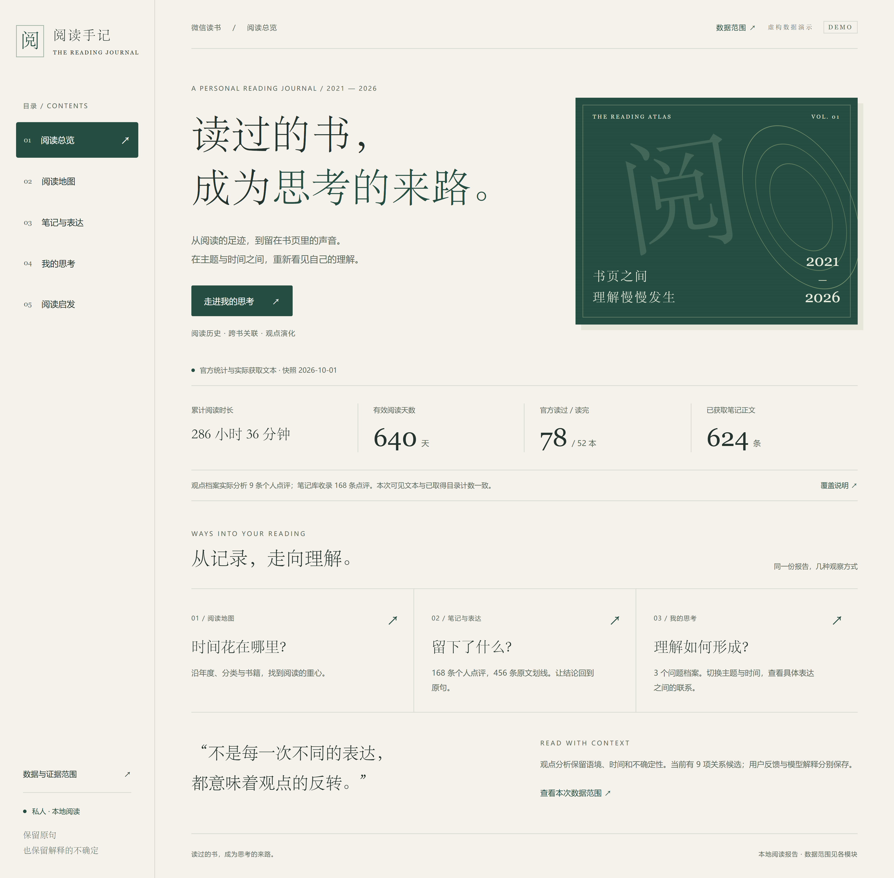

# WeRead Deep Insights

微信读书深度阅读画像工具。它通过 WeRead Agent Gateway 导出个人书架、阅读进度、阅读统计、笔记、划线和个人点评，由 Python 提供可复现统计和证据校验，可选使用宿主大模型或模型 API 进行语义分析，生成可离线查看的 Markdown 与 HTML 报告。

默认命令仍使用本地规则，不发送笔记给模型服务。增强模式支持新主题发现、点评立场辨析、跨书联系和有日期依据的表达变化，并为每项结论展示原始证据、适用范围与局限。结构与引用校验不能代替对结论含义的人工核验。

## PC 网页预览

阅读手记采用侧边栏导航，将基础阅读统计、笔记与表达、主题关联和观点时间线整合到同一份报告中。

[](assets/screenshots/reading-journal-desktop-demo.png)

> 图片仅用于展示网页外观。阅读统计、书籍、点评与观点关系均为虚构示例，不含真实用户数据，也不代表实际模型分析结果。生成此样式的完整报告请参阅下方“整合阅读手记网页”。

## 功能

- 汇总累计阅读时长、读书天数、读过/读完书籍、书架结构和笔记覆盖情况。
- 展示阅读主题、常见问题意识与有证据支持的表达线索，区分关键词信号和语义归纳。
- 基于个人笔记和点评抽取证据片段，避免只靠关键词做空泛判断。
- 展示可见数据中的集中信号，并给出有依据的可选阅读、写作和思考练习；缺失主题不等于个人盲区。
- 输出自包含 HTML 报告和 Markdown 报告。
- 区分请求成功、成功但为空、失败、未请求及旧数据状态未知，展示采集和文本覆盖情况。
- 证据不足时不归纳画像、不诊断盲区、不评分；可计算分数仅表示明示的观察比例。
- 可选大模型语义分析，通过输入摘要绑定、独立证据 ID、原文引用校验与明确弃答保持结论可追溯。
- 长数据按书籍分块，预算不足时标明部分覆盖；支持缓存、增量复用、调用上限与失败回退。

## 使用方式

### 1. 克隆仓库

```bash
git clone https://github.com/SpaceTrave1/weread-deep-insights.git
cd weread-deep-insights
```

先设置 `WEREAD_API_KEY` 环境变量，或在项目根目录创建本地 `.env` 文件：

```bash
WEREAD_API_KEY=your_api_key
```

### 2. 本地运行

本工具只依赖 Python 标准库，不需要安装第三方 Python 包。配置好 `WEREAD_API_KEY` 后，直接运行生成器：

```bash
python scripts/generate_deep_report.py --format both --output-dir ./weread-reports
```

常用参数：

```bash
python scripts/generate_deep_report.py \
  --format html \
  --output-dir ./weread-reports \
  --title "我的微信读书深度画像"
```

### 3. 在 AI Agent 应用中运行

这个仓库包含 `SKILL.md` 和 `agents/openai.yaml`，可以作为本地 skill/工具项目被支持本地仓库、文件读写和命令执行的 AI Agent 应用使用，例如 WorkBuddy、OpenClaw、Codex，以及其他兼容本地 skill 或可执行 shell 命令的应用。

如果应用支持读取本地 skill，可以让它使用本仓库执行微信读书数据分析；如果应用不支持 `SKILL.md`，也可以让它在仓库根目录直接运行：

```bash
python scripts/generate_deep_report.py --format both --output-dir ./weread-reports
```

不同应用的 skill 自动发现机制可能不同，但本项目的核心能力不依赖特定客户端。只要应用能访问仓库文件、读取环境变量并执行 Python 命令，就可以调用本工具。

### 4. 是否需要大模型

三种方式均只依赖 Python 标准库：

| 方式 | 使用方式 | 数据边界 |
| --- | --- | --- |
| 本地规则 | 原命令直接运行 | 不调用模型 |
| Skill 增强 | 导出分析包，由当前 Agent 的模型分析，再校验导入 | 当前宿主接触选中正文，遵循宿主数据政策 |
| API 增强 | 显式开启模型上传并配置服务与模型 | 正文发送至用户配置的端点 |

准备本地分析包和宿主请求：

```bash
python scripts/generate_deep_report.py --export-analysis-bundle ./weread-reports/analysis_bundle.json
python scripts/analyze_bundle.py --mode prepare --input ./weread-reports/analysis_bundle.json --output ./weread-reports/analysis_requests.json
```

支持该 Skill 的 Agent 按请求协议生成 `llm_insights.json` 后，离线校验并渲染：

```bash
python scripts/generate_deep_report.py --analysis-input ./weread-reports/analysis_bundle.json --analysis-result ./weread-reports/llm_insights.json --format both
```

第二、第三条命令不请求微信读书，不读取 `.env`。分析包默认遮盖邮箱和常见手机号，但仍包含阅读内容，不等于完整匿名化。API 模式显式开启上传后才读取专用环境变量 `WEREAD_LLM_API_KEY`，不复用微信读书密钥。

完整参数、长数据宿主流程、结果协议与风险见 [大模型分析指南](references/llm-analysis.md)。尚未进行真实模型质量或账户集成评测，不能把结构校验通过视为分析准确率。

## 阅读观点的长期演化（实验性）

新增阅读历史、观点演化和跨书关联入口：保留本地笔记版本，发现延续、深化、扩展、修正/反转和待解释的张力；每项候选展示日期、原文、上下文与反证，用户反馈可持久保存。个人点评是立场证据，划线仅提供背景。

```bash
python scripts/generate_deep_report.py --analysis-focus evolution --output-dir weread-reports/evolution
```

此命令采集并准备宿主模型请求；模型尚未处理时不会生成观点变化结论。随后使用当前 Agent 完成抽取与比较，再离线导入并生成报告。原 CLI 默认行为、分析包 1.0、标准库依赖和报告文件名保留。完整步骤、时间与身份局限、反馈、清理、预算及合成验收见 [阅读演化指南](references/reading-evolution.md)。独立语义质量验收尚未完成。

## 输出文件

- `weread_deep_report.md`
- `weread_deep_report.html`

报告内容可能包含个人阅读记录和笔记。默认 `.gitignore` 会排除 `.env`、缓存文件和本地报告输出目录，避免误传隐私数据。

## 目录结构

```text
agents/                 OpenAI/Codex skill metadata
assets/                 HTML report template
references/             分析口径与 API 覆盖说明
scripts/                报告生成脚本
tests/                  仅合成数据的离线单元测试、回归快照和 CLI 测试
SKILL.md                Codex skill instruction
```

## 依赖

只依赖 Python 标准库，不需要安装第三方 Python 包。

## 离线可靠性测试

从仓库根目录运行：

```bash
python -m unittest discover -s tests -v
```

测试只使用虚构书籍、点评、划线和模拟 API 响应，不需要 API Key，不读取 `.env`，禁止网络请求。输出测试使用 `tests/` 内的临时目录并自动清理；回归快照 `tests/snapshots/analysis.json` 也完全来自合成数据。

原有命令、参数和输出文件名保持不变。`scripts/generate_deep_report.py` 保留 CLI 与原有函数导出，内部逐步分为 `collection.py`（获取）、`analysis.py`（分析）、`rendering.py`（渲染），以及共享工具和覆盖口径模块。内部测试或调用者若要替换传输/环境加载，应在 `scripts.collection` 中注入模拟对象。

v0.2 第一阶段会改变部分报告内容和评分口径：缺少依据的分数为 `None`，两种报告显示“暂不评分”；部分获取结果只描述本次可见数据。依赖旧固定分数或报告原文的外部程序需要调整。具体问题、证据条件和验证记录见 [变更说明](references/v0.2-phase1-changes.md)。

合成语义评测准备与固定演示（均不需要密钥，不调用真实 API）：

```bash
python scripts/evaluate_llm.py --mode prepare
python scripts/create_synthetic_demo.py
```

评测集含 10 个虚构场景，区分开发集与留出集。语义质量字段保持未评分，待人工审阅；演示内容为固定编写的示例，不是真实模型质量评测。

## 整合阅读手记网页

观点时间线是完整报告的一部分。新的本地网页使用五个侧边栏模块：阅读总览、阅读地图、笔记与表达、我的思考、阅读启发。“我的思考”在主题视图与时间视图之间切换，同一问题可以跳转到有日期的原文档案。

只复用已经生成的私有文件，离线整合，不加载 `.env`，不请求微信读书或大模型接口：

```bash
python scripts/render_journal.py \
  --input ./weread-reports/analysis_bundle.json \
  --analysis-result ./weread-reports/llm_insights.json \
  --history-input ./weread-reports/evolution-history.json \
  --evolution-report ./weread-reports/evolution-report.json \
  --output-dir ./weread-reports/reading-journal
```

只有 `--input` 是必需的。模型结果基于另一个选中证据包时，用 `--semantic-input` 指定当时的原包；不能把结果绑定到不同选择范围。`--basis-input` 可提供更新的 `basis/annual/coverage`，必须与 `--history-input` 的采集覆盖一致。分类、书籍排名、规则和建议仍注明原报告快照，语义分析显示其原证据包日期。`--context-input` 是可选的、按笔记 entity ID 索引的书中原文背景，不作为本人立场。

输出自包含的 `index.html` 和保留基础分析及时间线的 `weread_deep_report.md`；支持 `--format html|markdown|both`。网页在浏览器本地搜索全部导入正文，每页展示 8 条。反馈导出为现有 `evolution.py feedback --input` 接受的三字段 JSON，由用户操作生成，尚未自动写入历史库。轨迹 ID 将反馈绑定到问题、原文版本和所审阅解释。原有生成器 CLI 和传统 HTML/Markdown 渲染方式保持不变。

个人网页、导入材料、截图和反馈都应保存在忽略的私有输出目录，不提交到 GitHub。设计方向、模块映射与验收边界见 [阅读手记设计说明](references/reading-journal-design.md)。
